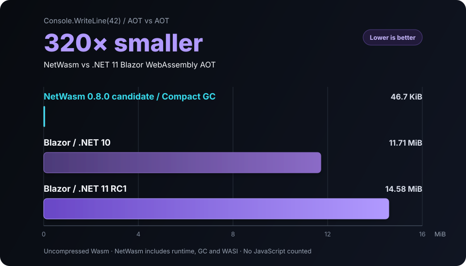

# NetWasm

**Independent .NET for WebAssembly and WASI.**<br>
Write C#. Deploy small, standalone Wasm.

NetWasm is an independent compiler, CoreLib, runtime and SDK that compiles C#
and .NET CIL directly to WebAssembly. It does not carry the desktop CLR, Mono,
`dotnet.js` or application DLLs into production.

[](https://github.com/zion-sati/NetWasm)
[](https://github.com/zion-sati/NetWasm/actions/workflows/release.yml)
[](docs/licensing.md)

[Compile C# to WebAssembly](https://www.netwasm.com/compile-csharp-to-webassembly/) ·
[Try it in the browser](https://playground.netwasm.com/) ·
[Install and build](#try-it) ·
[See supported APIs](docs/support-status.md) ·
[Read the documentation](docs/index.md)

## C# now beats Rust on Wasm size

**NetWasm 0.8.0 + precise GC: 47,798 bytes**<br>
**Rust 1.95.0 size-oriented profile: 53,635 bytes**

For the same print-`42` workload, NetWasm's result includes the runtime and
precise Compact garbage collector. Both artifacts are standalone WASI Preview 2
Components built with size-oriented settings.

**10.9% smaller raw. 20.4% smaller with Brotli-11.**


| Toolchain | Raw Wasm | Brotli 11 | Comparison role |
| --- | ---: | ---: | --- |
| **NetWasm 0.8.0, Compact GC** | **47,798 B** | **13,501 B** | WASI P2 Component; precise GC included |
| Rust 1.95.0, size profile | 53,635 B | 16,963 B | Matched WASI P2 Component reference |
| Kotlin 2.4.0 `wasmWasi` | 79,293 B | 22,655 B | P1 context; GC supplied by the host engine |
| TinyGo 0.39.0 | 93,043 B | 26,931 B | P1 context; precise GC configured |

Rust is the headline comparison because it uses the same workload and output
form. Kotlin/Wasm and TinyGo show the broader footprint landscape, but their
targets and runtime boundaries differ. This is a measured workload/profile
result, not a language-wide size ranking.

[Exact sources, versions, settings and reproduction steps](docs/size-and-methodology.md)

## More than Hello World

The 46.7 KiB program is the baseline, not the boundary.

**C# 15** · **Web Workers** · **static `.a` interop** · **WIT/WASI P2** ·
**expression trees** · **HTTP/JSON/XML/Regex** · **reflection-free DI** ·
**TUnit/VSTest** · **wasm64** · **four allocation strategies**

Today NetWasm can:

- build, run, publish and test projects through the ordinary `dotnet` CLI;
- publish browser [C# Web Workers](docs/web-workers.md) with generated
  JavaScript clients;
- link compatible Wasm [`.a` archives](docs/static-native-interop.md) and
  generate bounded C ABI marshalling;
- [generate C# bindings from WIT](docs/wit-bindings.md) and produce standalone
  WASI P2 Components;
- construct and inspect expression trees without general runtime reflection;
- use independently packaged LINQ, HTTP, JSON, XML, Regex, Hashing and
  dependency-injection libraries;
- dual-target libraries for `netwasm0.1` and desktop .NET.

The profile is deliberately smaller than desktop .NET. It already supports
complete applications, portable libraries, test projects and browser workers.

## Try it

Install [.NET SDK 10.0.303 or newer](https://dotnet.microsoft.com/download/dotnet/10.0),
then run:

```sh
dotnet new install NetWasm.Templates
dotnet new netwasm-app -n HelloNetWasm
cd HelloNetWasm
dotnet restore
dotnet run
dotnet publish -c Release -o publish/local
```

Run the published component with a compatible WASI Preview 2 host, such as
[Wasmtime](https://wasmtime.dev/):

```sh
wasmtime run publish/local/HelloNetWasm.wasm
```

```text
42
```

The published component is self-contained with respect to .NET. A WebAssembly
host is still required. **Build with .NET; run without .NET.**

Projects using C# 15 select the .NET 11 SDK; earlier language versions can stay
on .NET 10. The SDK restores its pinned Node, LLD and Binaryen tools through
NuGet, so an ordinary app does not require a separate Emscripten, Git or Python
installation. See the [complete quickstart](docs/sdk-quickstart.md) for host,
restore, Windows, browser and dual-targeting details.

## How it stays small

Roslyn produces CIL. NetWasm compiles the reachable program directly to Wasm,
specializes its generics and links only the runtime support it needs. The linked
Wasm component is the program.

- **Closed-world compilation.** Unreachable code, imports and runtime features
  do not enter the artifact.
- **A smaller platform contract.** NetWasm supports portable APIs instead of
  reproducing every desktop runtime assumption.
- **No broad runtime reflection.** Runtime type names, dynamic assembly loading
  and the `dynamic` keyword are outside the profile.
- **Generated boundaries.** JSON, DI, WIT and native interop use known contracts
  rather than runtime discovery.
- **Optional data and diagnostics.** Timezone data, rich stack traces and other
  deployment data are included only when selected.
- **One collector.** Only the chosen allocation strategy is linked.

This is a new .NET platform, not desktop .NET squeezed into a Wasm sandbox.
That boundary is what makes native-Wasm-sized C# possible.

[How JSON and optional features affect size](docs/size-and-methodology.md#json-is-not-one-fixed-cost)

## Choose your allocation strategy

Compact is the default: a size-first, precise, non-moving mark-and-sweep
collector. It traces compiler-published roots and reference layouts without
conservative scanning. Its name refers to implementation size, not moving heap
compaction.

| Strategy | Best fit | Raw component | Brotli 11 |
| --- | --- | ---: | ---: |
| **Compact (default)** | Small applications and low-churn UI | **47,798 B** | **13,501 B** |
| NetWasmGC | Higher allocation throughput | 51,300 B | 15,157 B |
| Bump | Bounded, one-shot jobs | 43,794 B | 11,929 B |
| Boehm | Conservative collector compatibility | 74,142 B | 25,023 B |

Select a strategy in the executable project's `.csproj`:

```xml
<PropertyGroup>
  <NetWasmGarbageCollector>NetWasm</NetWasmGarbageCollector>
</PropertyGroup>
```

Leaving the property unset selects Compact. Libraries remain collector-neutral;
all four backends are packaged for wasm32 and wasm64. See
[Choosing a garbage collector](docs/runtime-garbage-collection.md) for the
tradeoffs and diagnostics.

## Libraries should travel upward

A library written for the smaller NetWasm profile should also be useful on
desktop .NET, rather than trapped in a Wasm-only ecosystem.

```sh
dotnet new netwasm-lib -n MyLibrary
```

The template targets `netwasm0.1` and `net10.0`, producing NuGet assets for
both platforms. This is explicit multi-targeting, not a promise that arbitrary
desktop packages work in reverse.

[NetWasm.Libraries](https://github.com/zion-sati/NetWasm.Libraries) provides the
ported framework and extensions packages.
[TUnit-NetWasm](https://github.com/zion-sati/TUnit-NetWasm) provides ordinary
`dotnet test` integration through the generic VSTest bridge.

## How does this compare to conventional .NET Wasm?

For an empty-UI Blazor WebAssembly application that prints `42`, with AOT,
managed trimming, IL stripping, invariant globalization and size-focused native
linking enabled:



| AOT build | Uncompressed Wasm | Relative to NetWasm |
| --- | ---: | ---: |
| **NetWasm 0.8.0, Compact GC** | **47,798 B** | **1×** |
| Blazor WebAssembly, .NET 10 | 12,276,684 B | 257× |
| Blazor WebAssembly, .NET 11 RC1 | 15,289,241 B | 320× |

The Blazor total includes its native runtime and required Webcil assemblies;
NetWasm includes its runtime, garbage collector and WASI component. This is a
console component versus an empty-UI application—not an equivalent-framework
comparison or a claim about every .NET workload.

[Exact Blazor versions, settings and reproduction](docs/size-and-methodology.md#blazor-webassembly-aot-printing-42)

## Current boundary

NetWasm is pre-1.0. Its supported profile is usable today and covered by
published qualification, but source, package, target-profile and ABI contracts
may change between minor releases.

The normal portable output is a wasm32 WASI Preview 2 Component. Raw wasm32,
raw wasm64 and JavaScript-host integration are advanced alternatives; wasm64
Components remain blocked by upstream tooling.

Runtime reflection, `dynamic`, runtime assembly loading and managed threading
are outside the profile. General `System.IO.File`/`Directory`/`FileStream`, raw
sockets and subprocess APIs are not yet implemented. Existing NuGet packages
work only when their reachable code and API dependencies fit the supported
profile.

[Supported APIs and limitations](docs/support-status.md) ·
[Documentation index](docs/index.md)

## Road to 1.0

NetWasm 1.0 means a useful, documented and stable smaller platform. It does not
mean “desktop .NET, but in Wasm.” The main remaining themes are:

- broader WASI Preview 2 coverage;
- globalization modes and optional culture data;
- expression-tree completion;
- a faster incremental development loop;
- a stable `netwasm1.0` platform and runtime contract;
- production diagnostics and broader host qualification.

**Coming in NetWasm 0.9.0:** broader compatibility with existing .NET Standard
2.1 library binaries and NuGet assets. The target is to consume libraries
unchanged when their reachable code fits the NetWasm profile, without carrying
unused unsupported paths into the application.

This does not turn NetWasm into desktop .NET. Reachable general runtime
reflection, `dynamic`, runtime assembly loading, managed threading, unsupported
host APIs and named-culture globalization remain outside the initial 0.9.0
compatibility slice and fail at compile time.

[Read the full 1.0 roadmap](docs/roadmap.md)

## Packages

<details>
<summary>Compiler, SDK, runtime and hosting packages</summary>

[NetWasm.Compiler.Browser](https://www.nuget.org/packages/NetWasm.Compiler.Browser) ·
[NetWasm.Compiler.Tasks](https://www.nuget.org/packages/NetWasm.Compiler.Tasks) ·
[NetWasm.Hosting](https://www.nuget.org/packages/NetWasm.Hosting) ·
[NetWasm.Hosting.Build](https://www.nuget.org/packages/NetWasm.Hosting.Build) ·
[NetWasm.Ref](https://www.nuget.org/packages/NetWasm.Ref) ·
[NetWasm.Runtime.Pack](https://www.nuget.org/packages/NetWasm.Runtime.Pack) ·
[NetWasm.Runtime.Wasm32](https://www.nuget.org/packages/NetWasm.Runtime.Wasm32) ·
[NetWasm.Runtime.Wasm64](https://www.nuget.org/packages/NetWasm.Runtime.Wasm64) ·
[NetWasm.Sdk](https://www.nuget.org/packages/NetWasm.Sdk) ·
[NetWasm.Templates](https://www.nuget.org/packages/NetWasm.Templates) ·
[NetWasm.Testing.VSTest](https://www.nuget.org/packages/NetWasm.Testing.VSTest) ·
[NetWasm.Toolchain](https://www.nuget.org/packages/NetWasm.Toolchain) ·
[NetWasm.Wit.Bindings.Tool](https://www.nuget.org/packages/NetWasm.Wit.Bindings.Tool)

[Ported-library packages](https://github.com/zion-sati/NetWasm.Libraries#packages) ·
[TUnit packages](https://github.com/zion-sati/TUnit-NetWasm#netwasm-packages)

</details>

## License

CoreLib, runtime libraries, templates and generated support code are MIT,
subject to preserved upstream notices. The compiler and developer tooling use
the [NetWasm Community License 1.0](LICENSES/LicenseRef-NetWasm-Community-1.0.txt).
The Compact collector retains its Apache-2.0 license and AssemblyScript
attribution.

The Community License is free for qualifying individuals, education,
open-source work, evaluation, and organizations with fewer than 250 employees
and less than USD 10,000,000 in annual revenue. Matching
[GitHub Sponsors tiers](https://github.com/sponsors/zion-sati) grant limited
internal commercial use; OEM and Commercial Offering use require a separate
agreement. Generated applications may use their authors' chosen licenses.
There is no sign-in, activation, telemetry or technical enforcement.

[Licensing guide](docs/licensing.md) ·
[Third-party notices](THIRD-PARTY-NOTICES.md) ·
Commercial licensing: <zionsatidev@gmail.com>

## Bring a workload

Start with `Console.WriteLine(42)`, then try the smallest real workload where
deployment size, sandboxing or portability matters. If something is missing,
open an [issue](https://github.com/zion-sati/NetWasm/issues). Concrete workloads
are how the 1.0 support boundary gets decided.
